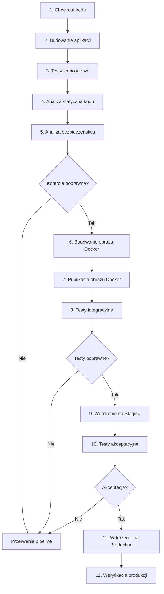

W pipeline CI/CD w Jenkinsie poszczególne etapy są ze sobą powiązane w taki sposób, aby każdy kolejny krok bazował na wynikach poprzedniego. Celem jest automatyczne sprawdzenie poprawności kodu, jego jakości i bezpieczeństwa, a następnie bezpieczne wdrożenie aplikacji.

Poniżej wyjaśnienie zależności między poszczególnymi etapami.

## 1. Zależności między etapami pipeline’u

mermaid

## 2. Szczegółowe zależności

### 1. Checkout kodu → Budowanie aplikacji

- Jenkins pobiera kod źródłowy z repozytorium Git.
- Następnie przygotowuje środowisko budowania.
- Pobiera wymagane biblioteki i zależności.
- Tworzy pliki wykonywalne lub pakiet aplikacji.

Zależność: bez pobrania aktualnego kodu nie można rozpocząć procesu budowania.

### 2. Budowanie → Testy jednostkowe

- Aplikacja jest kompilowana lub przygotowywana do uruchomienia.
- Uruchamiane są testy poszczególnych funkcji i modułów.
- Sprawdzana jest poprawność działania logiki biznesowej.

Zależność: testy jednostkowe wykorzystują kod i artefakty przygotowane podczas budowania.

Jeżeli testy zakończą się niepowodzeniem, pipeline powinien zostać zatrzymany.

### 3. Testy jednostkowe → Analiza statyczna kodu

- Po sprawdzeniu poprawności funkcjonalnej kod poddawany jest analizie statycznej.
- Narzędzie, np. SonarQube, wykrywa potencjalne błędy, duplikację kodu i problemy jakościowe.
- Można ustawić Quality Gate, który określa minimalny poziom jakości.

Zależność: poprawność testów nie oznacza automatycznie, że kod jest dobrej jakości. Oba etapy kontrolują inne aspekty aplikacji.

### 4. Analiza statyczna → Analiza bezpieczeństwa

- Sprawdzana jest jakość i struktura kodu.
- Następnie analizowane są zależności aplikacji pod kątem znanych podatności.
- Można również skanować sekrety, konfigurację i kod źródłowy.

Przykładowe narzędzia:

- SonarQube – jakość kodu.
- OWASP Dependency-Check – podatności zależności.
- Trivy – podatności obrazów i zależności.

Zależność: przed przygotowaniem obrazu do wdrożenia należy upewnić się, że aplikacja spełnia wymagania bezpieczeństwa.

### 5. Analiza bezpieczeństwa → Budowanie obrazu Docker

- Po pozytywnym przejściu kontroli Jenkins buduje obraz Docker.
- Obraz zawiera aplikację, wymagane biblioteki i środowisko uruchomieniowe.
- Obraz otrzymuje odpowiedni tag, np. numer wersji lub commit SHA.

Zależność: obraz powinien być tworzony z wcześniej zweryfikowanego kodu i artefaktów.

### 6. Budowanie Docker → Testy integracyjne

- Obraz Docker jest publikowany w rejestrze, np. Harbor lub Docker Registry.
- Następnie uruchamiane są kontenery aplikacji i wymaganych usług.
- Weryfikowana jest komunikacja między komponentami, np. aplikacją, bazą danych i API.

Zależność: testy integracyjne powinny sprawdzać rzeczywisty obraz kontenera, który będzie później wdrażany.

### 7. Testy integracyjne → Staging

- Pozytywny wynik testów integracyjnych pozwala przejść do wdrożenia.
- Jenkins wdraża aplikację na środowisko staging.
- Środowisko to powinno możliwie wiernie odwzorowywać produkcję.

Zależność: staging służy do sprawdzenia aplikacji w warunkach zbliżonych do rzeczywistego środowiska produkcyjnego.

### 8. Staging → Testy akceptacyjne

- Wykonywane są testy end-to-end (E2E).
- Sprawdzane są najważniejsze scenariusze użytkownika.
- Wykonywane są testy smoke, które potwierdzają podstawową dostępność aplikacji.

Zależność: przed produkcją trzeba potwierdzić, że aplikacja działa poprawnie jako całość, a nie tylko na poziomie pojedynczych komponentów.

### 9. Testy akceptacyjne → Produkcja

- Po pozytywnej weryfikacji staging następuje zatwierdzenie wdrożenia.
- Jenkins może wymagać ręcznej akceptacji administratora.
- Następnie wdrażany jest przetestowany obraz Docker na środowisko produkcyjne.

Zależność: wdrożenie produkcyjne jest uzależnione od pozytywnych wyników wcześniejszych etapów i ewentualnej akceptacji człowieka.

### 10. Produkcja → Weryfikacja wdrożenia

- Jenkins sprawdza dostępność aplikacji.
- Wykonywane są testy health check.
- Monitorowane są błędy i podstawowe parametry działania.

Zależność: samo wdrożenie nie gwarantuje poprawnego działania aplikacji. Konieczna jest weryfikacja po wdrożeniu.

## 3. Co się dzieje, gdy jeden z etapów zakończy się błędem?

Pipeline wykorzystuje mechanizm warunkowego przechodzenia między etapami.

| Etap | Przykładowy błąd | Działanie Jenkinsa |
| --- | --- | --- |
| Build | Błąd kompilacji | Przerwanie pipeline |
| Testy jednostkowe | Nieprawidłowy wynik testu | Przerwanie pipeline |
| SonarQube | Nieprzejście Quality Gate | Blokada dalszych etapów |
| Security | Krytyczna podatność | Blokada dalszych etapów |
| Docker | Błąd budowania obrazu | Przerwanie pipeline |
| Testy integracyjne | Błąd komunikacji API | Przerwanie pipeline |
| Staging | Nieudane wdrożenie | Brak promocji na produkcję |
| Produkcja | Nieudany health check | Alarm i ewentualny rollback |

## 4. Najważniejsza zależność – przepływ artefaktów

Warto zwrócić szczególną uwagę na to, że pipeline nie tylko przekazuje sterowanie pomiędzy etapami, ale również przekazuje wyniki swojej pracy.

Building a Local Dev Platform with Kubernetes, Tilt and Local Gitlab Pipelines | by Ahmad Asmar | Apr, 2026 | Medium

[medium.com](<https://medium.com/%40ahmed.asmar/building-a-local-dev-platform-with-kubernetes-tilt-and-local-gitlab-pipelines-ab534d428c82?utm_source=chatgpt.com>)

Przykładowy przepływ:

1. Git dostarcza kod źródłowy.
2. Build tworzy artefakt aplikacji.
3. Testy i analiza sprawdzają jego poprawność.
4. Docker pakuje aplikację do obrazu.
5. Registry przechowuje obraz.
6. Staging uruchamia obraz w środowisku testowym.
7. Production uruchamia ten sam obraz w środowisku produkcyjnym.

Kluczowa zasada CI/CD: ten sam, niezmieniony obraz Docker powinien przechodzić przez staging i production. Nie należy budować nowego obrazu na potrzeby produkcji, ponieważ mogłoby to spowodować różnice między wersją przetestowaną a wdrożoną.

## 5. Podsumowanie

Zależności w pipeline można sprowadzić do pięciu głównych zasad:

- Kolejność: każdy etap wykorzystuje wyniki poprzednich etapów.
- Walidacja: kolejne etapy rozpoczynają się tylko po spełnieniu określonych warunków.
- Automatyzacja: Jenkins sam uruchamia testy, analizy i wdrożenia.
- Bezpieczeństwo: błędy krytyczne i podatności mogą blokować wdrożenie.
- Powtarzalność: ten sam artefakt jest promowany pomiędzy środowiskami.

Dzięki temu pipeline CI/CD minimalizuje ryzyko wdrożenia wadliwej wersji aplikacji i zapewnia kontrolowany przepływ zmian od programisty do użytkownika końcowego.