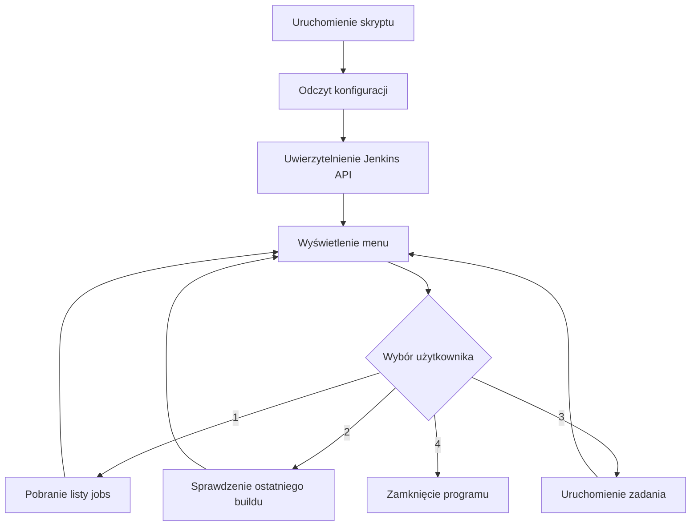

Skrypt `jenkins_manager.py` jest prostym narzędziem do automatyzacji zarządzania zadaniami w Jenkinsie za pomocą Jenkins REST API. Pozwala komunikować się z serwerem Jenkins bez konieczności korzystania z interfejsu przeglądarkowego.

Poniżej wyjaśniam jego działanie, wykorzystane biblioteki oraz przedstawiam przykłady użycia.

## 1. Jak działa skrypt?

Skrypt składa się z dwóch głównych elementów:

- Klasy `JenkinsManager` – odpowiada za komunikację z Jenkins API.
- Funkcji `main()` – wyświetla menu i obsługuje polecenia użytkownika.

Schemat działania:

mermaid



### A. Inicjalizacja połączenia

Klasa `JenkinsManager` przyjmuje trzy parametry:

python

```python
JenkinsManager(
    url,
    username,
    api_token
)
```

- `url` – adres serwera Jenkins.
- `username` – nazwa użytkownika.
- `api_token` – token API użytkownika.

Następnie tworzona jest sesja HTTP:

python

```python
self.session = requests.Session()
self.session.auth = HTTPBasicAuth(username, api_token)
```

Dzięki temu każde zapytanie do Jenkinsa wykorzystuje te same dane uwierzytelniające.

### B. Listowanie wszystkich zadań

Metoda:

python

```python
jenkins.list_jobs()
```

Wysyła zapytanie:

http

```http
GET /api/json?tree=jobs[name,url,color]
```

Jenkins zwraca dane w formacie JSON.

Przykładowa odpowiedź:

json

```json
{
  "jobs": [
    {
      "name": "Build-Application",
      "url": "https://jenkins.example.com/job/Build-Application/",
      "color": "blue"
    },
    {
      "name": "Deploy-Application",
      "url": "https://jenkins.example.com/job/Deploy-Application/",
      "color": "red"
    }
  ]
}
```

Pole `color` informuje o stanie zadania:

| Kolor | Znaczenie |
| --- | --- |
| `blue` | Ostatni build zakończony sukcesem |
| `red` | Ostatni build zakończony błędem |
| `yellow` | Build zakończony niestabilnie |
| `aborted` | Build przerwany |
| `blue_anime` | Build w trakcie wykonywania |

### C. Sprawdzanie statusu ostatniego buildu

Metoda:

python

```python
jenkins.get_last_build_status("Build-Application")
```

Wykorzystuje endpoint:

http

```http
GET /job/Build-Application/lastBuild/api/json
```

Pobierane są następujące informacje:

- `number` – numer buildu.
- `result` – wynik buildu.
- `building` – informacja, czy build nadal trwa.
- `timestamp` – czas rozpoczęcia.
- `url` – adres buildu.

Przykładowa odpowiedź:

json

```json
{
  "number": 25,
  "result": "SUCCESS",
  "building": false,
  "timestamp": 1794230000000,
  "url": "https://jenkins.example.com/job/Build-Application/25/"
}
```

Skrypt rozróżnia dwa przypadki:

python

```python
status = (
    "BUILDING"
    if build.get("building")
    else build.get("result", "UNKNOWN")
)
```

Jeśli build trwa, wyświetla `BUILDING`. W przeciwnym przypadku wyświetla wynik, np. `SUCCESS` lub `FAILURE`.

### D. Uruchamianie zadania

Metoda:

python

```python
jenkins.trigger_job("Build-Application")
```

Wysyła żądanie:

http

```http
POST /job/Build-Application/build
```

Jenkins dodaje zadanie do kolejki wykonywania.

W odpowiedzi zazwyczaj zwraca nagłówek `Location`, wskazujący adres kolejki.

Ważne: uruchomienie zadania nie oznacza, że build natychmiast się rozpocznie. Jenkins może najpierw umieścić go w kolejce.

## 2. Jakich bibliotek używa skrypt?

Skrypt wykorzystuje przede wszystkim bibliotekę `requests` oraz kilka standardowych bibliotek Pythona.

| Biblioteka | Zastosowanie |
| --- | --- |
| `requests` | Wysyłanie zapytań HTTP do Jenkins API |
| `HTTPBasicAuth` | Uwierzytelnianie loginem i API Tokenem |
| `RequestException` | Obsługa błędów komunikacji HTTP |
| `os` | Odczytywanie zmiennych środowiskowych |
| `sys` | Zakończenie programu z kodem błędu |

### Najważniejsza biblioteka: requests

Biblioteka `requests` umożliwia komunikację z REST API.

Przykładowo:

python

```python
response = requests.get(
    "https://jenkins.example.com/api/json",
    auth=HTTPBasicAuth("admin", "token"),
    timeout=15
)
```

Najważniejsze metody:

- `requests.get()` – pobieranie danych.
- `requests.post()` – wysyłanie żądań, np. uruchamianie buildów.
- `response.json()` – konwersja odpowiedzi JSON na obiekt Pythona.
- `response.raise_for_status()` – zgłaszanie błędów HTTP.

Nie jest potrzebna osobna biblioteka do Jenkins API, ponieważ Jenkins udostępnia standardowy interfejs REST API.

## 3. Instalacja i konfiguracja

### Krok 1. Instalacja requests

bash

```bash
pip install requests
```

Możesz sprawdzić instalację:

bash

```bash
python -c "import requests; print(requests.__version__)"
```

### Krok 2. Konfiguracja zmiennych środowiskowych

Linux / macOS:

bash

```bash
export JENKINS_URL="https://jenkins.example.com"
export JENKINS_USER="admin"
export JENKINS_TOKEN="twoj_api_token"
```

Windows PowerShell:

powershell

```powershell
$env:JENKINS_URL="https://jenkins.example.com"
$env:JENKINS_USER="admin"
$env:JENKINS_TOKEN="twoj_api_token"
```

### Krok 3. Uruchomienie skryptu

bash

```bash
python jenkins_manager.py
```

## 4. Przykładowe użycie skryptu

Po uruchomieniu zobaczysz menu:

text

```text
===== JENKINS MANAGER =====
1. Lista wszystkich zadań
2. Status ostatniego buildu
3. Uruchom zadanie
4. Wyjście

Wybierz opcję:
```

### Przykład 1. Wyświetlenie wszystkich zadań

Wpisz:

text

```text
Wybierz opcję: 1
```

Przykładowy wynik:

text

```text
=== LISTA ZADAŃ ===

Nazwa: Build-Application | Status: blue | URL: https://jenkins.example.com/job/Build-Application/

Nazwa: Deploy-Application | Status: red | URL: https://jenkins.example.com/job/Deploy-Application/
```

### Przykład 2. Sprawdzenie ostatniego buildu

Wpisz:

text

```text
Wybierz opcję: 2
Nazwa zadania: Build-Application
```

Przykładowy wynik:

text

```text
=== STATUS: Build-Application ===

Build number: 25
Status: SUCCESS
URL: https://jenkins.example.com/job/Build-Application/25/
```

Możliwe wyniki:

- `SUCCESS` – build zakończony sukcesem.
- `FAILURE` – build zakończony błędem.
- `UNSTABLE` – build zakończony niestabilnie.
- `ABORTED` – build został przerwany.
- `BUILDING` – build jest w trakcie wykonywania.
- `UNKNOWN` – Jenkins nie zwrócił określonego wyniku.

### Przykład 3. Uruchomienie zadania

Wpisz:

text

```text
Wybierz opcję: 3
Nazwa zadania: Build-Application
```

Przykładowy wynik:

text

```text
[SUCCESS] Zadanie 'Build-Application' zostało uruchomione.

Queue URL: https://jenkins.example.com/queue/item/123/
```

### Przykład 4. Zakończenie programu

text

```text
Wybierz opcję: 4
```

Program zamknie sesję HTTP i zakończy działanie.

## 5. Obsługa błędów

Skrypt posiada wspólną metodę `_request()`, która obsługuje błędy komunikacji.

Przykładowe sytuacje:

| Błąd | Możliwa przyczyna |
| --- | --- |
| HTTP 401 | Nieprawidłowy login lub token |
| HTTP 403 | Brak odpowiednich uprawnień |
| HTTP 404 | Nie znaleziono zadania |
| Connection Error | Jenkins jest niedostępny |
| Timeout | Serwer nie odpowiedział w określonym czasie |
| JSON Error | Nieprawidłowa odpowiedź JSON |

Przykładowy komunikat:

text

```text
[HTTP ERROR] Status 403: Forbidden
```

W takim przypadku należy sprawdzić uprawnienia użytkownika w Jenkinsie.

## 6. Możliwe rozszerzenia skryptu

Jeśli skrypt ma być wykorzystywany w większym środowisku DevOps, polecam rozważyć następujące rozszerzenia:

| Rozszerzenie | Korzyść |
| --- | --- |
| Historia ostatnich 10 buildów | Łatwiejsza analiza błędów |
| Parametryzowane buildy | Uruchamianie z różnymi parametrami |
| Monitorowanie buildów | Oczekiwanie na zakończenie zadania |
| Pobieranie konsoli | Analiza logów wykonania |
| Obsługa folderów | Zarządzanie zagnieżdżonymi zadaniami |
| Eksport do CSV | Raportowanie wyników |
| Integracja z harmonogramem | Automatyczne wykonywanie zadań |

Ważna uwaga techniczna: obecna implementacja pobiera zadania tylko z poziomu głównego Jenkinsa, a nazwy zadań są bezpośrednio wstawiane do ścieżek URL. Przy rozbudowie warto dodać obsługę folderów, poprawne kodowanie segmentów URL oraz obsługę parametrów buildów i CSRF Crumb Issuer.

## 7. Podsumowanie

Skrypt wykorzystuje prostą architekturę:

- Python odpowiada za logikę programu.
- `requests` realizuje komunikację HTTP.
- Jenkins REST API udostępnia informacje o zadaniach i buildach.
- API Token zapewnia uwierzytelnianie.
- JSON służy do wymiany danych pomiędzy Pythonem a Jenkinsem.

Dzięki temu można zautomatyzować podstawowe operacje Jenkinsowe i wykorzystać skrypt np. w procesach CI/CD, administracji środowiskiem testowym czy monitorowaniu pipeline'ów.